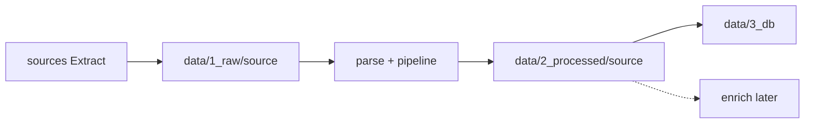

# Architecture

## Multi-service monorepo + EL-T data zone

```text
src/services/
  judgment_ingest/     # data pipeline (now)
  # contract_scanner/  # product (later)
  # api/               # HTTP trigger (later)

data/
  1_raw/<source>/      # Extract → Load RAW
  2_processed/<source>/
  3_db/                # SQLite now; Postgres/pgvector later
```

## EL-T flow

```text
CLI run
  → SourceRegistry
  → sources/* Extract (Atom API or future HTML)
  → storage writes data/1_raw/<source>/     # Load RAW (immutable)
  → adapter.parse + pipeline normalize/dedupe
  → storage writes data/2_processed/<source>/
  → storage/db upsert → data/3_db/
  → (later) enrich/ PII + embeddings → vector store
```

Re-parse without re-fetch: read from `1_raw/<source>/`, run transform again into `2_processed/`.



## Per-source fetch strategies

| Source | Transport | Rate policy |
| :--- | :--- | :--- |
| **fcl** | `atom_api` | Documented TNA limits; ~1s interval |
| **bailii** (later) | `html` | Conservative ~3s; observe 429s — do not probe |

## Design rules

- `data/1_*` / `2_*` / `3_*` = EL-T stage (easy to read).
- `src/services/<name>` = product/job capability.
- `sources/` = who we call on the internet (N adapters via registry).
- `pipeline/` = how one run is sequenced.
- `storage/` = where bytes and rows go.
- Create `enrich/`, `bailii.py`, `api/` only when coded — no empty theatre.
- Registry ≠ enable list (`JUDGMENT_INGEST_ENABLED_SOURCES`).

## How to add an Nth judgment source

1. Add `sources/<name>.py` with `transport`, `default_min_interval_s`, `search` / `fetch` / `parse`.
2. Register in `sources/registry.py`.
3. Files land automatically under `data/1_raw/<source_id>/` and `data/2_processed/<source_id>/`.
4. Enable via `JUDGMENT_INGEST_ENABLED_SOURCES` when ready.
5. Smoke: `judgment-ingest run --source <id> --limit 3 --dry-run`.

## CLI

```bash
judgment-ingest sources
judgment-ingest run --source fcl --limit 3
judgment-ingest run --source all
judgment-ingest status
```
